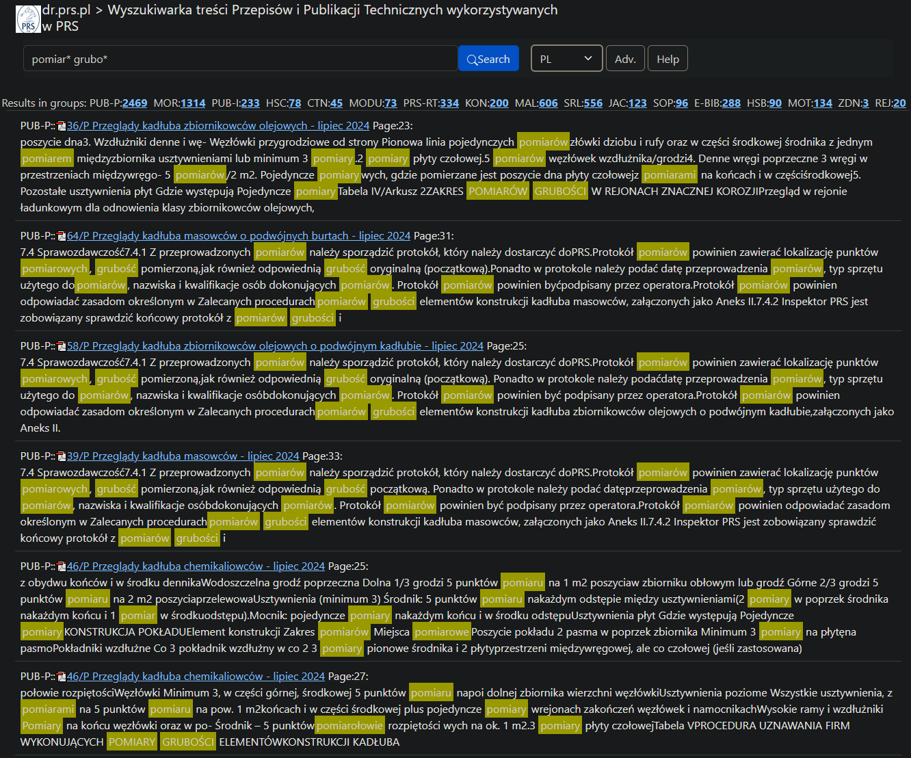
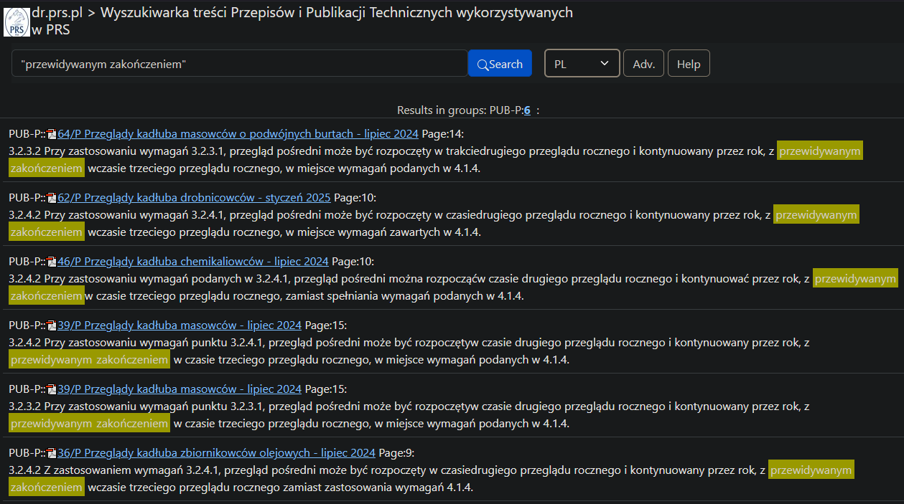
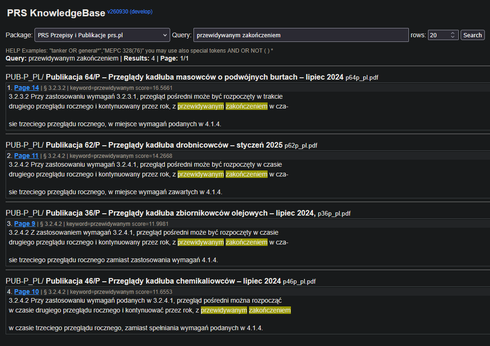
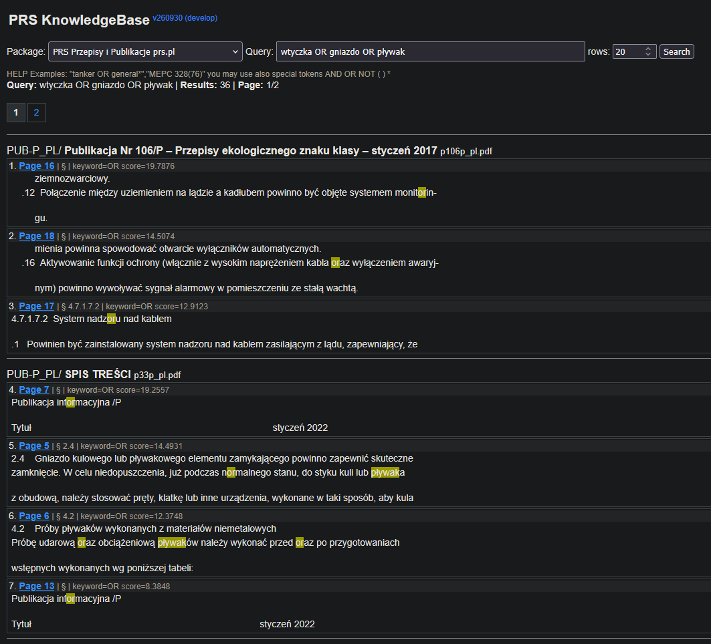
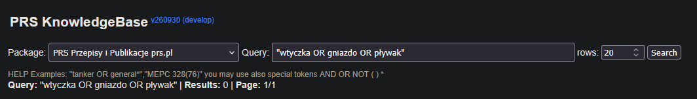
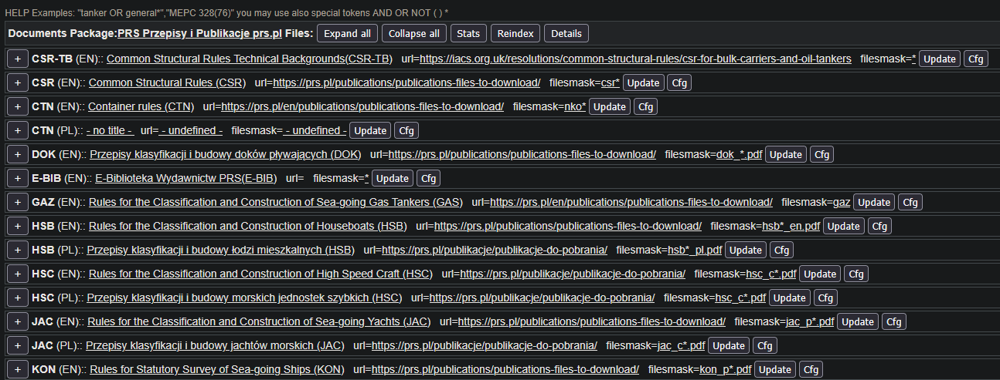

# Rules Search v2 eval<!-- omit in toc -->
_12.10.2026 pb_

- [Skrót ISSUES](#skrót-issues)
- [Wyszukiwanie](#wyszukiwanie)
  - [Wiele wyników w jednym pliku](#wiele-wyników-w-jednym-pliku)
  - [Line break](#line-break)
  - [Restrykcyjne wyszukiwanie](#restrykcyjne-wyszukiwanie)
  - [Operatory logiczne](#operatory-logiczne)
- [Funkcjonalność / UI](#funkcjonalność--ui)
  - [Details](#details)
  - [Metadane](#metadane)
  - [Fatal error](#fatal-error)
  - [Document expired](#document-expired)

## Skrót ISSUES

1. po kliknięciu w [Details](#details) nie da się wrócić do trybu `redakcja=0` z poziomu GUI, [przykład](https://dr.prs.pl/dev/rules-dms/index.php?redakcja=1&db=PRS-Rules)
2. [snippets](#wiele-wyników-w-jednym-pliku) powinny być listą rozwijalną, tak jak zawartości kategorii; obecnie wyniki z jednego pliku potrafią zająć kilka stron [przykład](https://dr.prs.pl/dev/rules-dms/?db=PRS-Rules&query=pomiar*%20grubo*&rowspage=20&maxresultsfile=10&page=1) `pomiar* grubo*`
3. [linebreak](#line-break) słowa rozbite myślnikiem na dwa wiersze nie są wyszukiwane, przykład `przewidywanym zakończeniem` [nowa-wyszukiwarka](https://dr.prs.pl/dev/rules-dms/?db=PRS-Rules&query=przewidywanym+zako%C5%84czeniem&cb_PL=on&cb_EN=on&rowspage=20), [stara-wyszukiwarka](https://dr.prs.pl/rulessearch/index.php?grp=PUB-P&lang=EN&keyword=przewidywanym%20zako%C5%84czeniem) stara znajduje PUB39/P a nowa nie
4. [restrykcyjność](#restrykcyjne-wyszukiwanie) nie wyświetla wyników gdy nie znajdzie każdego wyszukanego słowa, przykład `wtyczka gniazdo pływak` [link](https://dr.prs.pl/dev/rules-dms/?db=PRS-Rules&query=wtyczka+gniazdo+p%C5%82ywak&cb_PL=on&cb_EN=on&rowspage=20) brak wyników, [stara wyszukiwarka](https://dr.prs.pl/rulessearch/index.php?lang=PL&keyword=wtyczka%20gniazdo%20p%C5%82ywak) daje wyniki par słów
5. [operatory](#operatory-logiczne) AND/OR nie działają, funkcjonują jako zwykłe wyszukiwanie i znajdują słowa and/or lub fragmenty słów [przykład](https://dr.prs.pl/dev/rules-dms/?db=PRS-Rules&query=wtyczka+OR+gniazdo+OR+p%C5%82ywak&cb_PL=on&cb_EN=on&rowspage=20) `wtyczka OR gniazdo OR pływak`
6. [metadane](#metadane) wprowadzone ręcznie ulegają usunięciu przy nadpisaniu pliku pdf; powinny być dziedziczone
7. [wstecz](#fatal-error) często wywala fatal error, zwłaszcza w trybie admina
8. [document expired](#document-expired) błąd wyświetlany przy przerwaniu jakiejś procedury bez jej finalizacji

## Wyszukiwanie

### Wiele wyników w jednym pliku

W sytuacji gdy znalezionych jest wiele rekordów w jednym pliku, wyszukiwarka wyświetla je wszystkie. Czasami trzeba przejść na kolejną stronę, żeby się przez nie przebić. W starej wyszukiwarce rekordy były agregowane (jeśli dostatecznie blisko siebie) i sortowane globalnie, a nie w obrębie jednego pliku; dzięki temu można było przejrzeć najwazniejsze wyniki z różnych plików dość szybko.

Dobrze rozwiązane to jest w wyszukiwarce *recoll*. Wyszukania z każdego pliku są agregowane w jeden rekord i wyświetlone jeden po drugim jako blok tekstu. Na każdy plik przypada tylko jeden blok. Po kliknięciu w niego przechodzi się do podstrony zawierającej szczegóły wyszukania w danym pliku --- *snippets* (fragmenty) oraz odpowiadające im strony w pliku PDF.

Nowa wyszukiwarka:


Stara wyszukiwarka:



### Line break

Klasyczny problem, który rozwiązaliśmy w starej wersji przeglądarki, a w nowej jeszcze nie. Przykładowo fraza `przewidywanym zakończeniem` jest rozbita w pliku PUB 39/P myślnikiem:


Stara wyszukiwarka poprawnie odnajduje ten wynik (jako jeden z sześciu):



W nowej widoczne są tylko cztery wyszukania, gdzie fraza nie jest rozbita:



### Restrykcyjne wyszukiwanie

Domyślne wyszukiwanie jest zbyt restrykcyjne, a operatory AND/OR nie działają. Przykładowo, słowa `wtyczka gniazdo pływak` nie są w ogóle odszukane, gdyż w żadnym dokumencie nie występują obok siebie:


W starej wyszukiwarce odnajdywane są istniejące pary z tych trzech słów:


### Operatory logiczne

Operatory logiczne zdają się nie działać; OR wyszukiwane jest jako słowo lub fragment słowa.



Przykład z Helpa sugeruje użycie cudzysłowia w tym przypadku, ale to również nie działa:



## Funkcjonalność / UI

### Details

Włączenie trybu Details uniemożliwia jego późniejsze wyłączenie z poziomu GUI; nawet po wciśnięciu Collapse all pozostają url i filemask. Trzeba ręcznie usunąć tryb redakcja=1 z adresu url (niedostępne z poziomu dokuwiki przez iframe).



### Metadane

Wgranie nowego pliku PDF, nawet identycznego jak poprzedni, powoduje nadpisanie (wyzerowanie) jego ręcznie wprowadzonych metadanych. Powinny być one "dziedziczone" jako wstępne wartości do dalszych modyfikacji.

### Fatal error

Czasami przy klikaniu WSTECZ (np. jeśli wybraliśmy upload_url, a potem jednak rezygnujemy) pojawia się komunikat:
```
Fatal error: Uncaught ValueError: Path cannot be empty in E:\dr_prs_pl_htdocs\search\.www\explorer.php:1732 Stack trace: #0 E:\dr_prs_pl_htdocs\search\.www\explorer.php(1732): fopen('', 'rb') #1 E:\dr_prs_pl_htdocs\search\.www\explorer.php(2104): FileManager->uploadFromUrl('', '') #2 E:\dr_prs_pl_htdocs\search\.www\explorer.php(3331): FileManager->run_fm(Object(Location)) #3 E:\dr_prs_pl_htdocs\search\dms.php(2): include_once('E:\\dr_prs_pl_ht...') #4 {main} thrown in E:\dr_prs_pl_htdocs\search\.www\explorer.php on line 1732
```

Adres URL to wtedy:
```
https://dr.prs.pl/search/dms.php?dir=
```

### Document expired

Często po kliknięciu wstecz w przeglądarce pojawia się błąd:

```
Document Expired

The requested document is not available in Firefox’s cache.
```

Towarzyszy mu zwykle adres:
```
https://dr.prs.pl/search/dms.php
```

Kilkukrotne wciśnięcie wstecz pozwala wrócić do poprzedniego menu.

Ogólnie brakuje `Wstecz` jako takiego zawartego w UI strony.